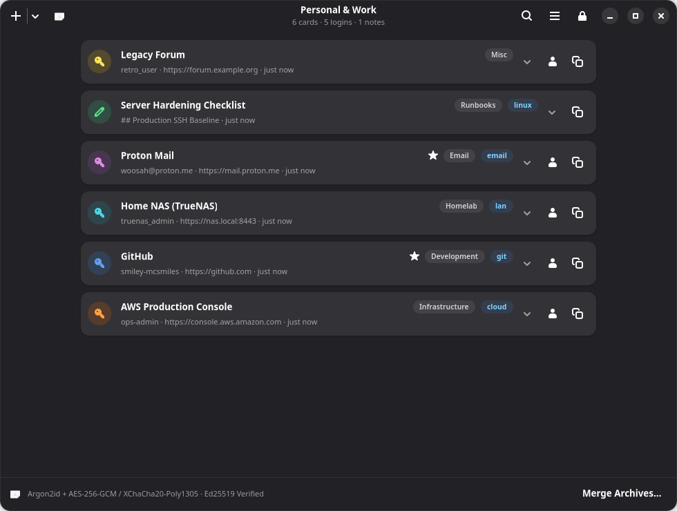
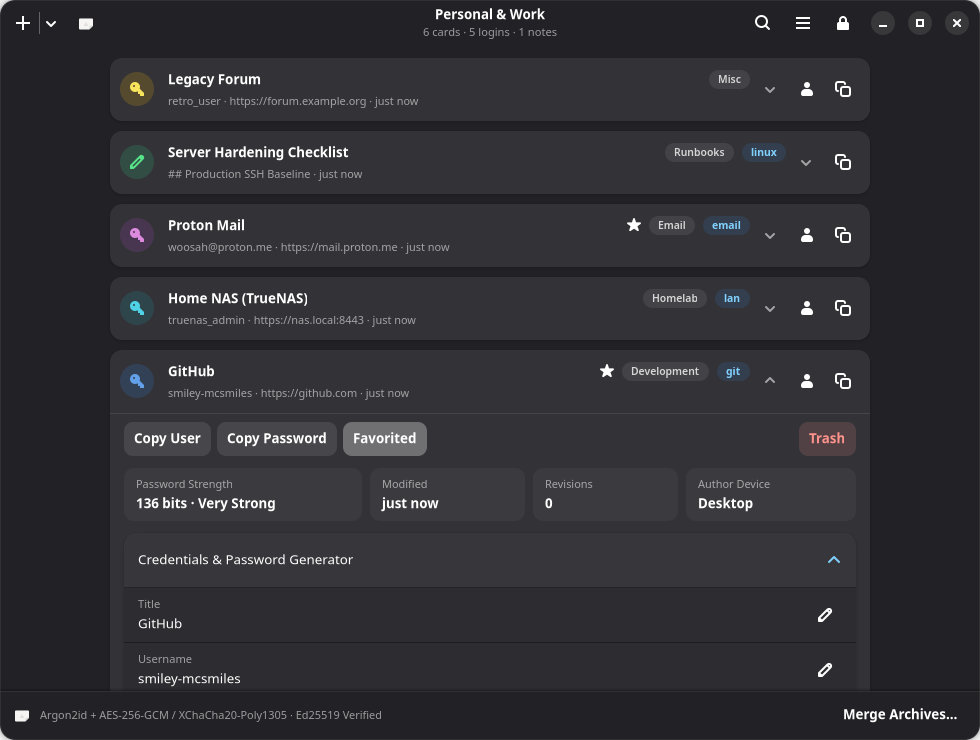

<div align="center">
  
  <h1>CipherDeck</h1>
  <p>
    <strong>An offline-first, cascade-encrypted password &amp; Markdown note vault for Linux</strong><br />
    Built with Rust, GTK 4, and Libadwaita — featuring field-level CRDT sync and zero-metadata padding.
  </p>

  <p>
    
    
    
    
    
  </p>
</div>

---

## Screenshots

<p align="center">
  
</p>
<p align="center">
  
</p>

---

## Features

- **Cascade AEAD Encryption (`.cdeck`)** — Keys derived via **Argon2id** + optional **BLAKE3 keyfile** + **HKDF-SHA512**, then encrypted with **AES-256-GCM** wrapped inside **XChaCha20-Poly1305**.
- **Ed25519 Signed &amp; Provenance-Tracked** — Every vault is signed with an Ed25519 device key, and each field revision records its author device and Hybrid Logical Clock (HLC).
- **Zero-Metadata Padding** — Compressed CBOR payloads are padded to 4 KiB buckets with CSPRNG bytes to obscure vault size.
- **Field-Level CRDT Sync &amp; Vault Merge** — Merge two or more `.cdeck` vaults without losing concurrent edits on different fields, while preserving full per-field revision history and tombstones.
- **Rich Interactive Markdown Notes** — Built-in Markdown editor and live preview with:
  - Interactive `[ ]` / `[x]` task checkboxes directly in preview
  - Fenced code blocks with language headers and one-click **Copy** buttons
  - Clickable `` `inline code` `` snippets that copy directly to the clipboard
  - `[[Card Links]]` to jump between related cards
- **KeePass `.kdbx` Import** — Import existing KeePass v3/v4 databases directly from the GUI or CLI.
- **CSPRNG Password &amp; Passphrase Generator** — Entropy estimation, strength badges, and customizable character/passphrase rules.
- **Desktop + CLI** — Native GTK4 / Libadwaita app and CLI in one unified `cipherdeck` binary.

---

## Workspace Layout

| Crate | Description |
| :--- | :--- |
| [`crates/vault-core`](crates/vault-core) | Cryptography, `.cdeck` format, CRDT merge engine, `.kdbx` importer, password generator |
| [`crates/cipherdeck`](crates/cipherdeck) | GTK 4 / Libadwaita desktop application &amp; unified `cipherdeck` CLI |

---

## Building from Source

### Prerequisites

- **Rust** (stable toolchain via `rustup`)
- **GTK 4** (`>= 4.14`) and **Libadwaita** (`>= 1.6`) development headers
  - **Fedora / RHEL:** `sudo dnf install gtk4-devel libadwaita-devel gcc`
  - **Ubuntu / Debian:** `sudo apt install libgtk-4-dev libadwaita-1-dev build-essential`
  - **Arch Linux:** `sudo pacman -S gtk4 libadwaita base-devel`

### Build &amp; Run

```bash
# Build and run the desktop app (or pass a CLI subcommand)
cargo run --release -p cipherdeck

# Build the release binary
cargo build --release -p cipherdeck
```

---

## Packaging (`.rpm`, `.deb`, `.tar.gz`)

Use the included [`package.sh`](package.sh) script to build release binaries and generate distributable packages in `dist/`:

```bash
./package.sh
```

This creates:
- `dist/cipherdeck-<version>-linux-<arch>.tar.gz` (includes `install.sh`)
- `dist/cipherdeck_<version>_<arch>.deb`
- `dist/cipherdeck-<version>-1.<arch>.rpm`

---

## CLI Usage (`cipherdeck`)

Run `cipherdeck` with no arguments to launch the desktop GUI, or pass a subcommand:

```bash
# Create a new vault
cipherdeck init personal.cdeck --name "Personal"

# Inspect a vault's header, KDF parameters, and Ed25519 signature status
cipherdeck info personal.cdeck

# Import a KeePass .kdbx database
cipherdeck import-kdbx legacy.kdbx -o personal.cdeck

# Merge multiple vaults with field-level CRDT sync
cipherdeck merge desktop.cdeck phone.cdeck -o merged.cdeck

# Generate a strong password
cipherdeck gen --length 24
```

---

## License

Licensed under the [MIT License](LICENSE).
